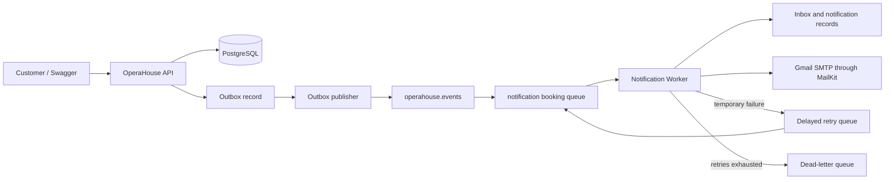

# OperaHouse

OperaHouse is a .NET 10 learning and portfolio project for building a production-oriented opera and concert ticketing platform with RabbitMQ.

The project deliberately uses bare `RabbitMQ.Client` instead of MassTransit so exchanges, queues, bindings, routing keys, acknowledgements, retries, dead-lettering, publisher confirms, inbox, and outbox behaviour remain visible in the code.

## Current capabilities

- Browse available performances.
- Create a pending guest booking using an email address.
- Retrieve a booking by ID.
- Save booking data in PostgreSQL through EF Core.
- Save an outbox message in the same transaction as a booking.
- Expire unpaid reservations, release seats, and save a `booking.expired` outbox event.
- Publish `booking.created` and `booking.expired` through RabbitMQ with publisher confirms.
- Consume messages using manual ACK and NACK.
- Retry transient processing failures through a delayed retry queue.
- Move exhausted messages to a dead-letter queue.
- Deduplicate consumed events using an inbox table.
- Persist notification processing status.
- Send real email through MailKit and Gmail SMTP.
- Propagate message and correlation identifiers through the flow.
- Check PostgreSQL and RabbitMQ health.

## Current message flow



## Solution structure

Business code lives in named Booking, Performance, and Notification projects. Each area has a physical parent folder, mirrored by solution folders in the IDE. The API is the single running host for HTTP and background services.

```text
src/
├── Api/
│   └── OperaHouse.Api/
│       ├── Controllers/         # BookingsController, PerformancesController
│       ├── Models/Bookings/    # HTTP request binding
│       ├── Errors/
│       └── Security/
├── Booking/
│   └── OperaHouse.Booking/
│       ├── Features/           # CreateBooking, GetBooking, ExpireBookings
│       ├── Models/
│       ├── Configuration/
│       └── Persistence/        # Booking repository contract
├── Performance/
│   └── OperaHouse.Performance/
│       ├── Features/           # Browse, list, get, create, update, publish, cancel
│       ├── Models/
│       ├── Shared/             # Shared performance input/validation
│       └── Persistence/        # Performance repository contract
├── Notification/
│   └── OperaHouse.Notification/
│       ├── Features/           # SendBookingConfirmation, SendBookingExpiration
│       ├── Processing/
│       ├── Persistence/
│       ├── Email/
│       └── Messaging/
└── Shared/
    ├── Persistence/OperaHouse.Persistence/
    ├── Contracts/OperaHouse.Contracts/
    └── Messaging/OperaHouse.Messaging/
tests/
└── Regression/OperaHouse.RegressionTests/
```

| Project | Responsibility |
| --- | --- |
| **Api** | Controllers, HTTP error mapping, authorization, configuration, and startup of all background services. |
| **Booking** | Booking creation/retrieval, reservation expiration, validation, models, and booking persistence contract. |
| **Performance** | Performance browsing and administration, lifecycle rules, validation, models, and performance persistence contract. |
| **Notification** | Event consumption, notification features, inbox/outcome persistence, and email submission. |
| **Persistence** | Shared booking/performance EF context, migrations, concrete repositories, atomic seat/reservation/outbox writes, and outbox publication. |
| **Contracts** | Integration events and transport-independent application results/errors. |
| **Messaging** | RabbitMQ publisher, broker options, and broker health check. |

Each use case keeps its handler, input, and validator together under its business project's `Features` folder. The API has one controller for bookings and one for performances. Shared persistence keeps seat allocation and booking state in a single transaction without making either business project depend on the other. Notification retains its own database model.

See [Architecture](docs/ARCHITECTURE.md) for ownership and transaction boundaries.

## Technology

- .NET 10
- ASP.NET Core Web API
- .NET background services hosted by the API
- Entity Framework Core
- FluentValidation
- PostgreSQL 17
- RabbitMQ 4 with Management UI
- `RabbitMQ.Client` 7.x
- MailKit and Gmail SMTP
- Docker Compose
- Swagger UI

## Prerequisites

- .NET 10 SDK
- Docker Desktop
- An IDE such as JetBrains Rider or Visual Studio
- A Gmail account with two-step verification and an App Password for local email testing

## Local setup

### 1. Start infrastructure

From the repository root:

```powershell
docker compose up -d
```

PostgreSQL is exposed on host port `54400`. RabbitMQ uses `5672`, and its Management UI is available at [http://localhost:15672](http://localhost:15672).

Local RabbitMQ credentials are defined in `docker-compose.yml`.

Check the containers:

```powershell
docker compose ps
```

### 2. Restore and build

```powershell
dotnet restore
dotnet build
```

### 3. Apply EF Core migrations

Booking database:

```powershell
dotnet ef database update `
  --project src/Shared/Persistence/OperaHouse.Persistence `
  --startup-project src/Api/OperaHouse.Api `
  --context BookingDbContext
```

Notification database:

```powershell
dotnet ef database update `
  --project src/Notification/OperaHouse.Notification `
  --startup-project src/Api/OperaHouse.Api `
  --context NotificationDbContext
```

Both contexts currently use the same local PostgreSQL database while retaining separate EF Core models and responsibilities.

### 4. Configure Gmail locally

Never put the Gmail App Password in `appsettings.json` or commit it.

Store the settings in the API host’s .NET User Secrets:

```powershell
dotnet user-secrets set "Email:Host" "smtp.gmail.com" --project src/Api/OperaHouse.Api
dotnet user-secrets set "Email:Port" "587" --project src/Api/OperaHouse.Api
dotnet user-secrets set "Email:UserName" "your-address@gmail.com" --project src/Api/OperaHouse.Api
dotnet user-secrets set "Email:Password" "YOUR_GOOGLE_APP_PASSWORD" --project src/Api/OperaHouse.Api
dotnet user-secrets set "Email:FromAddress" "your-address@gmail.com" --project src/Api/OperaHouse.Api
dotnet user-secrets set "Email:FromName" "OperaHouse" --project src/Api/OperaHouse.Api
dotnet user-secrets set "Email:UseStartTls" "true" --project src/Api/OperaHouse.Api
```

Use a Google App Password, not the normal Gmail account password. In Development, the host also reads the existing Notification project secrets, so the move preserves earlier local email settings. API secrets take precedence; environment variables and command-line settings override both.

### 5. Run the application

Run the API host; it also starts notification consumption, booking expiration, outbox publication, and dependency health logging:

```powershell
dotnet run --project src/Api/OperaHouse.Api
```

Open [HTTP Swagger](http://localhost:5286/swagger). In Development, HTTP requests stay on HTTP; outside Development the host redirects them to HTTPS. The HTTPS launch profile is also available when the local development certificate is trusted.

## API endpoints

| Method | Route | Purpose |
| --- | --- | --- |
| `GET` | `/performances` | List customer-visible performances |
| `POST` | `/bookings` | Create a pending guest booking |
| `GET` | `/bookings/{id}` | Retrieve a booking |
| `GET` | `/health` | Check API dependencies |

## RabbitMQ topology

| Purpose | Name |
| --- | --- |
| Events exchange | `operahouse.events` |
| Booking-created routing key | `booking.created` |
| Booking-expired routing key | `booking.expired` |
| Created notification queue | `notification-booking-created.queue` |
| Expired notification queue | `notification-booking-expired.queue` |
| Retry exchange | `operahouse.retry` |
| Created retry queue | `notification-booking-created.retry.queue` |
| Expired retry queue | `notification-booking-expired.retry.queue` |
| Dead-letter exchange | `operahouse.dead-letter` |
| Created dead-letter queue | `notification-booking-created.dead-letter.queue` |
| Expired dead-letter queue | `notification-booking-expired.dead-letter.queue` |

All important exchanges and queues are durable. Published business messages are persistent, and the consumer uses manual acknowledgements.

## Documentation

- [Architecture](docs/ARCHITECTURE.md)
- [Development roadmap](docs/ROADMAP.md)
- [Messaging debugging runbook](docs/messaging-debugging.md)
- [Regression checks](tests/README.md)
- [Project collaboration rules](PROJECT_RULES.md)
- Additional design and use-case documents are available in the `docs` directory.

See the [roadmap](docs/ROADMAP.md) for the current reservation work, an early Azure deployment with Terraform, and the later payment, ticketing, invoicing, and production-readiness chapters. Tests, security, telemetry, and infrastructure changes are introduced alongside each feature.

## Important production note

Gmail SMTP is the current local email integration. Postmark is the preferred production email provider; its integration is planned for the first Azure deployment chapter. The existing `IEmailSender` boundary keeps provider details out of the application workflow.
