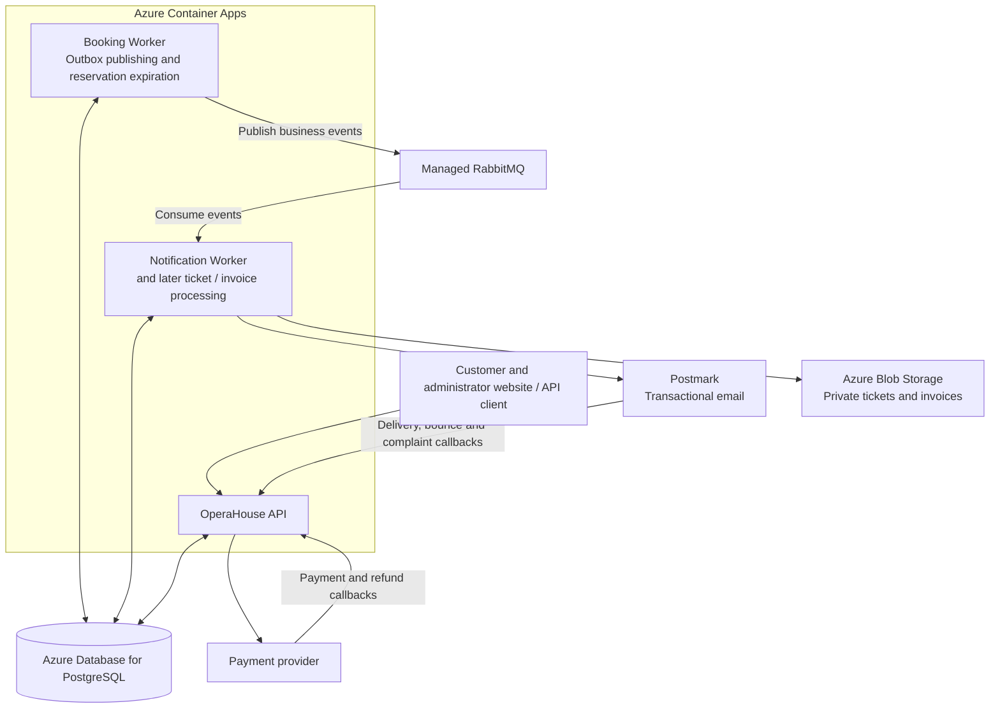

# OperaHouse Development Roadmap

OperaHouse is a .NET learning and portfolio project: build an opera and concert booking system while understanding how reliable messaging works with bare `RabbitMQ.Client`.

The intended customer journey is:

**Browse a performance → reserve seats → pay → receive tickets and an invoice.**

We will build and deploy this journey a chapter at a time. The first Azure deployment happens after reservations and expiration work locally. Later features bring their infrastructure, tests, security, and diagnostics with them. The final chapter prepares an already deployed system for production operation.

Last reviewed: **1 November 2026**. Status distinguishes source implementation from infrastructure verification. The vertical-slice consolidation retains the existing database schema and migration history; local database/broker execution and cloud deployment still require separate verification.

## Start here

| Chapter | Outcome | Current position |
| --- | --- | --- |
| 1. Booking and basic messaging | Create a booking and tell the notification worker about it. | Foundation implemented. |
| 2. Reliable messaging and email | Persist messages, retry failures, recognize completed processing, and send email. | Most foundation code exists; verification and reliability gaps remain. |
| 3. Performance administration | Let authorized administrators manage performances. | Main use cases implemented; lifecycle and database verification remain. |
| 4. Complete reservations and expiration | Reserve seats safely, release them correctly, and notify the customer. | **Current chapter.** Created/expired consumers are implemented; failure classification, unpaid cancellation, and infrastructure verification remain. |
| 5. First Azure deployment | Run the reservation flow in a small Azure environment using Terraform and Postmark. | Planned, before payments. |
| 6. Payments | Confirm a reservation after a verified payment. | Planned; deploy with the feature. |
| 7. Tickets and document storage | Issue downloadable tickets for confirmed bookings. | Planned; add Blob Storage here. |
| 8. Invoices | Produce an invoice from the completed purchase. | Planned; extend existing storage and processing. |
| 9. Cancellation and refunds | Handle paid cancellations, refunds, and cancelled performances. | Planned; extends unpaid cancellation from Chapter 4. |
| 10. Customer access and notification experience | Add customer accounts and improve the complete communication journey. | Planned; guest access is secured earlier. |
| 11. Production readiness | Prove recovery, scaling, security, and operational procedures. | Planned; builds on checks introduced throughout. |

**Next small task:** classify permanent versus transient email failures, then finish unpaid cancellation and the PostgreSQL/RabbitMQ verification work. Complete Chapter 4 before starting the first Azure deployment.

## How to use this roadmap

- `[x]` means implementation exists in the repository. It does not mean the feature has passed local or cloud verification.
- `[~]` means partially implemented or awaiting verification.
- `[ ]` means planned work.
- Work on one chapter and one manageable task at a time. Later chapters describe direction, not work that must start immediately.
- Chapters 1–3 preserve the foundation already built. Their remaining checks are carried into Chapters 4 and 5.
- From Chapter 5 onward, a feature is complete when it passes its relevant local checks and its deployed acceptance checks.

The collaboration rules remain in [`PROJECT_RULES.md`](../PROJECT_RULES.md).

## Architecture

The current solution has named Booking, Performance, and Notification business projects, a single API host, and shared Persistence, Contracts, and Messaging projects. Physical area folders wrap every project and are mirrored in the solution. Business use cases keep their handlers, inputs, and validators together; the API has one controller per resource. Shared persistence preserves the atomic seat/reservation/outbox transactions.

See [Architecture](ARCHITECTURE.md) for responsibilities. The API host starts notification consumption, outbox publication, expiration, and health logging. The diagram below is a later Azure deployment target; independent worker hosts would be introduced at that stage.

This is the planned system; the chapters introduce its parts incrementally. Ticket and invoice processing is added to an appropriate worker when needed and does not require a separate deployment from the start.

Across these applications: **Entra** handles staff/customer identity, **managed identities** provide application access to Azure services, **Key Vault** holds provider secrets, and **OpenTelemetry → Azure Monitor / Application Insights** provides diagnostics. **Terraform + GitHub Actions** provision and release the system. Redis remains an optional addition for a measured caching need.

| Component | Intended responsibility | Hosting or service |
| --- | --- | --- |
| OperaHouse API | Customer requests, admin endpoints, payment callbacks, and protected provider callbacks. | Azure Container Apps. |
| Booking Worker | Publish the Booking outbox and expire unpaid reservations independently of HTTP traffic. | Azure Container Apps; a new worker host is still needed. |
| Notification Worker | Consume business events, persist notification outcomes, and send emails. | Azure Container Apps; a separate host would be introduced when splitting deployment. |
| Ticket and invoice processing | Generate documents and publish the corresponding business events. | Add to an appropriate worker when introduced; split only when justified. |
| Business database | Performances, reservations, payments, and related processing records. | Azure Database for PostgreSQL Flexible Server. Initially one server, with explicit data ownership and restricted database permissions. |
| Message broker | Durable exchanges, queues, retries, and dead-letter handling. | Managed RabbitMQ; CloudAMQP in an Azure region is a candidate, subject to plan and cost selection. |
| Email delivery | Transactional booking, expiration, ticket, invoice, and refund emails. | Postmark is the current preferred provider, behind `IEmailSender`. |
| Documents | Private ticket and invoice PDFs. | Azure Blob Storage, introduced with tickets. |
| Staff identity | Administrator sign-in and application roles. | Microsoft Entra ID workforce tenant. |
| Customer identity | Optional registered customer accounts, while preserving guest checkout. | Microsoft Entra External ID when customer accounts are introduced. |
| Application access to Azure | Let each application access only the services it needs. | Managed identities plus service-specific permissions. |
| Secrets | Postmark, payment, and broker credentials where secret-based authentication is required. | Azure Key Vault. |
| Telemetry | Correlated application logs, distributed traces, metrics, and alerts. | OpenTelemetry with Azure Monitor, Application Insights, and Log Analytics. |
| Packaging and deployment | Build images and deploy repeatable application and infrastructure versions. | Azure Container Registry, Terraform, and GitHub Actions. |
| Optional cache | Speed up measured read-heavy paths such as performance listings. | Azure Managed Redis only when a concrete use case warrants it. PostgreSQL remains authoritative for reservations. |

An OperaHouse administrator role controls product actions. Azure RBAC controls Azure resources. Managed identities belong to applications. Customer login is a separate concern from all three.

Keycloak remains an alternative if operating an identity platform becomes an explicit learning goal. It is not required for the Azure architecture above. A customer/admin website can be added as a separate product milestone; the current roadmap focuses on the backend and demonstrates it through API clients.

## Working principles

- Keep the code readable. Use standard patterns where they solve a real problem, and avoid speculative abstractions or a new microservice for every feature.
- Keep use-case inputs, validation, and orchestration in their feature slices. Keep shared business rules in module entities; keep provider integrations in their owning module and choose them through startup registration and configuration.
- Keep the same application behavior across local and Azure environments. External endpoints, credentials, and telemetry destinations come from configuration.
- Add tests for important business rules and failure cases as each feature is built. Extend the same deployment pipeline as the system grows.
- Introduce authentication, authorization, input protection, secret management, and observability alongside the endpoints and integrations that need them.
- Treat RabbitMQ delivery as **at least once**. Use stable message IDs and duplicate-safe processing. Publisher confirms and inbox records do not promise exactly-once external effects.
- Make new queues and bindings available before enabling their publishers. Test unroutable messages and retries; receiving a publish confirmation is not a substitute for correct routing.
- Start with a small deployed environment and representative test data. Track cloud costs from the first deployment.

## Chapter 1 — Booking and basic RabbitMQ flow

**Outcome:** a customer can create a pending guest booking, and a background consumer receives a `booking.created` event.

- [x] Create the .NET 10 solution; group use cases into named Booking and Performance projects, with resource controllers in the API and physical folders around each project.
- [x] Add PostgreSQL, EF Core, migrations, and `Performance` and `Booking` models.
- [x] Add `GET /performances`, `POST /bookings`, and `GET /bookings/{id}`.
- [x] Define `BookingCreated` and publish it to a durable topic exchange.
- [x] Declare a durable notification queue and binding.
- [x] Consume with `AsyncEventingBasicConsumer` and manual ACK/NACK.
- [x] Run PostgreSQL and RabbitMQ locally with Docker Compose.

**Verification carried forward:** recreate the local environment, apply migrations, and demonstrate this flow in Chapter 4. Secure access to customer booking details before exposing the deployed API in Chapter 5.

## Chapter 2 — Reliable messaging and initial email delivery

**Outcome:** a saved booking leaves a durable record of the message to send, and the notification worker tracks its work and handles failures.

### Existing foundation

- [x] Save a booking and its outbox message in the same database transaction.
- [x] Publish pending outbox records with persistent messages and publisher confirms.
- [x] Track publication failures and completion.
- [x] Declare delayed retry and dead-letter topology for booking-created notifications.
- [x] Limit retries and retain failure metadata.
- [x] Persist inbox records with a unique `(MessageId, Consumer)` constraint.
- [x] Skip messages already recorded as processed and persist notification results separately.
- [x] Keep notification features, inbox/send/outcome processing, persistence, email integration, and broker handling in the Notification project, hosted by the API.
- [x] Keep email delivery behind `IEmailSender` and implement MailKit SMTP delivery.
- [x] Add validated email options and document local Gmail User Secrets configuration.
- [x] Propagate message/correlation IDs and add logging scopes, health checks, and a health logging worker.
- [x] Add the [messaging debugging runbook](messaging-debugging.md).
- [~] Verify the full booking-to-email flow in a running local environment.

**Remaining work has an owner:** Chapter 4 completes failure classification, reliable retry publication, and basic DLQ inspection/replay. Chapter 5 introduces Postmark, delivery feedback, and cloud tracing. Later chapters extend these mechanisms to new events.

## Chapter 3 — Administration and performance management

**Outcome:** authorized staff can manage which performances customers can book.

- [x] Define performance states: `Draft`, `Published`, `Cancelled`, and `Completed`.
- [x] Show customers only published future performances.
- [x] Prevent reservations for unavailable performance states or past performances.
- [x] Add admin create, update, publish, cancel, and list operations.
- [x] Keep management actions on the API's Performances controller, require the Admin policy, and call the Performance slice handlers.
- [x] Add JWT bearer authentication, development tokens, and an administrator policy.
- [x] Keep public browsing and guest booking available without customer registration.
- [~] Verify the administration migration and complete lifecycle against a running database.

**Remaining work has an owner:** Chapter 4 checks the lifecycle locally. Chapter 5 configures Entra staff access and basic audit records before deployed administration is used.

## Chapter 4 — Complete reservations and expiration

**Outcome:** reservations hold only available seats, unpaid reservations release their seats correctly, and customers can receive expiration notifications.

The [remaining-work guide](CHAPTER-4-IMPLEMENTATION.md) records the next slices and verification steps. It links current source instead of providing full-file replacements for the superseded layered architecture.

This is the current chapter. Reservation state definitions exist, but confirmed and cancelled behavior must not be inferred from enum values alone. Payment-driven confirmation belongs to Chapter 6.

### 4.1 Reservation consistency already implemented

- [x] Reserve seats with an atomic conditional database update inside booking creation's transaction.
- [x] Reject creation when the performance is unavailable or insufficient seats remain.
- [x] Add booking request idempotency and a unique database constraint.
- [x] Define `Pending`, `Confirmed`, `Expired`, and `Cancelled` states and reservation timestamps.
- [x] Add database checks for valid seat counts, capacity bounds, and expiration after creation.
- [x] Add a configurable reservation duration and expiration background worker.
- [x] Conditionally expire pending bookings, release seats, and save the expiration outbox event in one transaction.

### 4.2 Finish expiration messaging

- [x] Define a self-contained `BookingExpired` event with customer email and reservation details.
- [x] Route expiration outbox messages through the persistent, confirmed publisher using `booking.expired`.
- [x] Declare durable expiration notification, retry, and dead-letter queues and bindings.
- [x] Implement the expiration notification slice using shared inbox/outcome processing and `IEmailSender`.
- [x] Consume expiration events through the expiration notification slice.
- [x] Use manual ACK/NACK, contextual outcome logging, and expiration-specific retry routing.
- [~] Reject malformed JSON and invalid event fields directly to the DLQ. Classify permanent versus transient email/provider failures for both event types.
- [x] Confirm retry publication before ACKing the original delivery; surface callback/channel failures to the session reconnect loop.
- [ ] Verify failed retry publication and original-message recovery against a running broker.
- [ ] Add a documented, controlled way to inspect and replay DLQ messages while preserving message identity.
- [ ] Verify topology is present before publishing and that unroutable events remain recoverable through the outbox.

### 4.3 Complete unpaid cancellation

- [ ] Implement cancellation of a pending unpaid reservation and transactional seat release.
- [ ] Make repeated cancellation and cancellation racing expiration safe; release seats only for the winning state transition.
- [ ] Add the cancellation event/notification path with its topology and consumer before enabling publication.
- [ ] Define the access contract for this operation; Chapter 5 must enforce ownership or secure guest access before public exposure.

### 4.4 Local verification and meaningful tests

- [x] Add a local regression runner for notification outcomes, invalid payloads, duplicate processing, retry/session handling, and UTC dates using in-process substitutes.
- [ ] Extend business-rule coverage and add a PostgreSQL/RabbitMQ integration-test setup.
- [ ] Apply existing migrations to a fresh database and verify an upgrade from the previous schema.
- [ ] Verify the admin lifecycle and create/get reservation flow against running services.
- [ ] Test concurrent requests for the last seats, repeated idempotency keys, and conflicting reuse of a key.
- [ ] Test repeated expiration, competing expiration workers, and cancellation racing expiration without extra seat release or extra logical events.
- [ ] Verify one logical outbox event per committed transition while allowing repeated publication/delivery after failures.
- [ ] Test completed-message duplicates, delayed retries, exhausted retries, permanent failures, and recovery after broker/worker restarts.
- [ ] Demonstrate a real booking email and expiration email to a controlled test recipient.
- [x] Document the email send-before-database-save failure window: inbox tracking alone cannot guarantee exactly-once email delivery.

SMTP tests are excluded from the current architecture refactor at the user's request. The controlled-recipient demonstration above remains a separate future acceptance check.

**Chapter complete when:** the local booking → reservation → expiration/cancellation → seat release → notification flow is demonstrated, and the important concurrency and messaging failure cases have repeatable checks.

## Chapter 5 — First Azure deployment with Terraform and Postmark

**Outcome:** the reservation flow runs in a small Azure staging environment with protected access, repeatable deployment, and enough diagnostics to follow one booking through the system.

Work through these sections in small steps. This chapter establishes the deployment foundation; it does not require every future service to be provisioned.

### 5.1 Package and host the existing application

- [ ] Introduce independent worker hosts for Notification and booking background jobs when splitting deployment; reuse the existing libraries and remove the corresponding hosted registrations from the API.
- [ ] Add container packaging for the API, Booking Worker, and Notification Worker, and run the images locally.
- [ ] Keep endpoints, provider choices, credentials, and environment settings in validated configuration.
- [ ] Add TLS and certificate validation for managed RabbitMQ and PostgreSQL connections.
- [ ] Configure connection recovery, startup retries, graceful shutdown, and useful liveness/readiness probes for the deployed processes.
- [ ] Keep the polling Booking Worker running independently of HTTP traffic. Begin with one active instance and controlled releases; verify behavior during revision overlap and restarts.
- [ ] Make outbox claiming safe before enabling multiple publisher instances. A configured replica limit does not prove that deployments never overlap.
- [ ] Start notification processing with conservative replica limits; enable queue-based scaling only after concurrent duplicate processing is tested.

### 5.2 Provision the first environment

- [ ] Add Terraform under `infra/terraform`, pin provider versions, and document the environment inputs and naming.
- [ ] Bootstrap protected remote state with locking, access control, and recovery/versioning; keep state, plan files, and credentials out of Git.
- [ ] Treat Terraform state as sensitive: marking a value `sensitive` hides output but does not by itself remove the value from state.
- [ ] Provision the resource group, Container Apps environment, three application resources, and Container Registry.
- [ ] Provision PostgreSQL Flexible Server with explicit Booking/Notification ownership, restricted database permissions, and backup settings.
- [ ] Select a managed RabbitMQ plan and configure the needed topology, TLS access, and restricted management access.
- [ ] Provision Key Vault, application managed identities, and the specific permissions each application needs. Configure database identity/token refresh where managed-identity authentication is selected.
- [ ] Provision Application Insights, Log Analytics, and an initial budget alert.
- [ ] Configure network access intentionally: protect database/broker management access, and give workers no public ingress unless an operational endpoint requires it.
- [ ] Manage supported third-party resources through Terraform or provider APIs where practical. Document domain verification and any remaining external setup steps so the environment is reproducible.

### 5.3 Integrate Postmark and delivery feedback

- [ ] Set up the sending domain, sender authentication, and a transactional Postmark message stream with separate test/production configuration.
- [ ] Add the Postmark implementation behind `IEmailSender`; keep local/test email options available without changing business workflows.
- [ ] Store the Postmark server token in Key Vault and let only the notification application read it through its managed identity.
- [ ] Persist the provider message ID and a stable internal notification identifier for correlation and reconciliation.
- [ ] Distinguish provider acceptance from delivery, bounce, and complaint outcomes; evolve the notification status model accordingly.
- [ ] Add protected delivery, bounce, and complaint webhook handling using Postmark-supported authentication. Do not assume Postmark signs callbacks like a payment provider.
- [ ] Persist feedback durably and handle duplicate or out-of-order callbacks without corrupting status.
- [ ] Define recovery for uncertain send outcomes, including a successful provider submission followed by a timeout or database failure; avoid blindly resending every uncertain request.
- [ ] Test accepted, delivered, failed, and repeated-callback cases, and demonstrate delivery to a controlled real recipient.

### 5.4 Secure the first deployed API

- [ ] Replace reliance on local development JWTs with Entra workforce authentication for deployed admin endpoints and an explicit application-role policy.
- [ ] Protect guest booking reads and cancellation with scoped, time-limited access credentials or equivalent ownership checks. A booking ID alone is not authorization.
- [ ] Keep guest checkout available; customer registration is introduced later.
- [ ] Add rate limiting and abuse protection to public booking and email-triggering paths, plus appropriate validation and request limits.
- [ ] Protect provider callbacks independently of customer/staff login, using each provider's supported mechanism.
- [ ] Add basic audit records for sensitive administration and avoid exposing development tools or broker management publicly.
- [ ] Keep secrets, access tokens, full email bodies, and unnecessary customer data out of logs and message headers.

### 5.5 Add diagnostics and a release pipeline

- [ ] Add structured application logs and OpenTelemetry traces/metrics to API and workers. Serilog/Seq may support local learning if useful; they are not prerequisites for Azure telemetry.
- [ ] Propagate trace context across HTTP requests, outbox records, RabbitMQ headers, and consumers. Correlation IDs alone are not a complete distributed trace.
- [ ] Export to Azure Monitor/Application Insights and verify request, database, messaging, and Postmark operations can be followed together.
- [ ] Track outbox age/backlog, queue depth, retry/DLQ activity, overdue reservations, and notification outcomes.
- [ ] Add GitHub Actions for build, relevant tests, image publishing, and release using federated Azure authentication.
- [ ] Coordinate Terraform plans/applies with application releases. Define which step owns image versions and application configuration so an infrastructure apply cannot silently revert a release.
- [ ] Run database migrations once as a controlled release step with a migration identity, rather than racing migrations from every application replica.
- [ ] Deploy required topology/consumers before enabling new event producers and use compatible schema/event changes during rollout.
- [ ] Add deployed smoke tests, record the image/infrastructure versions, and document application rollback plus database recovery expectations.
- [ ] Document creation, normal deployment, pause/teardown, and restoration of the staging environment, including which data must survive.

**Chapter complete when:** a clean documented setup and pipeline deployment can demonstrate admin access, protected guest access, booking, expiration/cancellation, seat release, Postmark submission and delivery feedback, and a useful trace in Azure. Worker restarts and a repeat deployment preserve correct behavior.

## Chapter 6 — Payments

**Outcome:** a valid payment confirms a reservation without confirming seats that have already been released.

### Application work

- [ ] Select a payment provider and integrate its sandbox behind a focused adapter.
- [ ] Model payment attempts and create a payment session only for an eligible pending reservation; derive amount/currency on the server.
- [ ] Verify webhook authenticity and expected booking, provider reference, amount, and currency. Do not confirm payment from a browser redirect alone.
- [ ] Persist callbacks and make payment state transitions duplicate-safe and tolerant of out-of-order delivery.
- [ ] Define the transaction/state rules for payment success racing expiration or cancellation. A late success must follow a defined reconciliation/refund path and cannot reclaim seats already released.
- [ ] Confirm a booking only after verified successful payment and publish the corresponding payment/booking events through the outbox.
- [ ] Add payment received/failed communication using the existing notification mechanisms.
- [ ] Add a reconciliation path for missing callbacks and uncertain provider outcomes.

### Infrastructure and verification with this feature

- [ ] Extend Terraform/configuration for payment secrets and the public HTTPS callback endpoint; keep provider administration steps documented.
- [ ] Add relevant authorization, audit records, telemetry, and payment failure alerts.
- [ ] Test successful/failed payment, duplicate callbacks, invalid signatures, mismatched amounts, missing callbacks, and payment racing expiration.
- [ ] Deploy the sandbox flow and verify the booking remains correct after restarts and replayed callbacks.

**Chapter complete when:** a deployed sandbox payment confirms the correct reservation, and late or repeated payment events follow the defined safe outcome.

## Chapter 7 — Tickets and Blob Storage

**Outcome:** a confirmed booking produces a ticket the customer can securely download.

### Application work

- [ ] Issue tickets only for confirmed bookings and enforce uniqueness for each issued entitlement.
- [ ] Generate ticket identifiers, QR/barcode values, and PDF documents through background processing.
- [ ] Add a document storage adapter, a local development implementation, and an Azure Blob Storage implementation.
- [ ] Make repeated events and partial document-generation/upload failures recoverable without issuing duplicate tickets.
- [ ] Publish `ticket.issued` and send the ticket email from that event. `booking.created` remains an acknowledgment of a temporary reservation.
- [ ] Authorize document access and use scoped download links; avoid public ticket containers.

### Infrastructure and verification with this feature

- [ ] Extend Terraform with storage accounts/containers, worker identity permissions, lifecycle settings, and required networking.
- [ ] Add processing topology before publishing ticket events; extend worker packaging only where a separate deployment is justified.
- [ ] Trace issuance and upload, record failures, and test access to another customer's document is denied.
- [ ] Verify locally and in Azure that retries/restarts preserve ticket identity and the emailed link retrieves the correct private PDF.

**Chapter complete when:** the deployed payment → confirmed booking → issued ticket → email/download flow works and duplicate processing does not create extra tickets.

## Chapter 8 — Invoicing

**Outcome:** the completed purchase produces a durable invoice based on the original transaction details.

- [ ] Define invoice issuance and numbering requirements for the intended operating jurisdiction before implementation.
- [ ] Preserve an immutable snapshot of the relevant financial and customer details and enforce uniqueness for invoice creation.
- [ ] Generate invoice numbers and PDFs through recoverable background processing after verified payment.
- [ ] Reuse the storage integration, add invoice-specific access/retention permissions, and publish `invoice.created`.
- [ ] Send invoice notifications with authorized download links or appropriate attachments.
- [ ] Extend Terraform, configuration, audit records, telemetry, and tests with the feature.
- [ ] Test duplicate events, failed uploads, changed performance/customer details, and denied access to another customer's invoice.
- [ ] Deploy and verify invoice creation, persistence, and download with a sandbox purchase.

**Chapter complete when:** each eligible deployed purchase has the intended unique invoice, and retries preserve its identity and financial snapshot.

## Chapter 9 — Paid cancellation, performance cancellation, and refunds

**Outcome:** cancellation updates the booking, payment, tickets, and customer communication consistently.

- [ ] Define cancellation deadlines, refund eligibility, seat-release rules, and behavior for whole-performance cancellation.
- [ ] Extend Chapter 4's unpaid cancellation flow to paid bookings with explicit refund states.
- [ ] Make refund requests and callbacks duplicate-safe, authenticate callbacks, and reconcile uncertain provider responses.
- [ ] Invalidate tickets according to the cancellation policy and prevent repeated seat release.
- [ ] Preserve financial records and add credit/refund documents where the invoicing requirements call for them.
- [ ] Publish cancellation, refund, and ticket-invalidation events with topology and consumers available before rollout.
- [ ] Notify customers about cancellation and refund progress through the existing notification flow.
- [ ] Extend provider permissions/configuration, audit records, metrics, alerts, and the deployment pipeline as needed.
- [ ] Test cancellation racing payment/ticket issuance, duplicate refunds, partial failures, and a cancelled performance with many bookings.
- [ ] Verify deployed sandbox refunds and recovery when a provider or worker becomes temporarily unavailable.

**Chapter complete when:** cancellation/refund outcomes are visible and recoverable, with correct seat availability and ticket validity.

## Chapter 10 — Customer access and the notification experience

**Outcome:** returning customers can access their own purchases, and every important event produces a clear, traceable communication.

- [ ] Add customer accounts through Entra External ID if account-based access is part of the intended product; retain secure guest checkout/access.
- [ ] Link accounts and guest purchases only through verified ownership, and enforce booking/document ownership on every relevant endpoint.
- [ ] Configure the customer tenant, app registrations, sign-in flows, and deployment settings alongside the feature; keep staff identity and Azure resource access separate.
- [ ] Add maintainable HTML/plain-text templates for reservation, expiration, payment, ticket, invoice, cancellation, and refund messages.
- [ ] Extend Postmark delivery/bounce/complaint tracking and suppression handling across all notification types.
- [ ] Add an audited support process for failed notifications and deliberate resends, building on earlier DLQ/reconciliation tools.
- [ ] Define retention/deletion and customer-data handling for the expanded account and communication records, including external providers.
- [ ] Extend authorization tests, telemetry, and deployed checks for account ownership, guest links, failed delivery, and repeated callbacks.

**Chapter complete when:** the deployed system gives guests and registered customers the intended access, and support can explain the outcome of each important notification.

## Chapter 11 — Production readiness and operation

**Outcome:** the deployed system has demonstrated recovery, safe releases, appropriate security, and capacity for its intended use.

This chapter deepens the tests, controls, and diagnostics introduced earlier. It is not the first deployment or the first security/testing phase.

### Reliability and performance

- [ ] Run end-to-end purchase, expiry, cancellation, and refund checks against the complete deployed system.
- [ ] Exercise PostgreSQL, broker, worker, email, and payment failures, including recovery after an external operation succeeds but local recording fails.
- [ ] Verify safe outbox claiming, inbox concurrency, and reservation transitions across multiple replicas and overlapping deployments before increasing scale limits.
- [ ] Configure and load-test API scaling and RabbitMQ-driven consumer scaling. Ensure polling tasks always have a running process or an explicit scheduled trigger.
- [ ] Test load on popular performances and agree measurable latency, backlog, and recovery targets.
- [ ] Add Azure Managed Redis only if measured read load justifies it; define invalidation and failure behavior and keep authoritative seat decisions in PostgreSQL.

### Security, recovery, and releases

- [ ] Review application roles, data ownership, guest links, callback authentication, network exposure, identity permissions, and dependency vulnerabilities.
- [ ] Exercise secret rotation and verify secrets/customer data are not leaked through logs, telemetry, Terraform outputs, or state access.
- [ ] Test database backup restoration and document file recovery; set recovery time/data-loss objectives suitable for the intended deployment.
- [ ] Rehearse compatible schema/event changes, rollback, and recovery from a failed migration or partial release.
- [ ] Review and implement the agreed retention/deletion requirements, audit trails, and financial-record retention.
- [ ] Recreate the environment from Terraform and documented external setup, verify drift detection, and keep staging/production data and credentials separate.

### Monitoring and handover

- [ ] Add actionable dashboards and alerts for failed payments, expiring reservations, outbox backlog, DLQs, document processing, and email delivery.
- [ ] Add availability checks and verify that important alerts lead to a documented response.
- [ ] Complete runbooks for deployment, migration, DLQ replay, uncertain external outcomes, refunds, backup restoration, and provider outages.
- [ ] Review service tiers, budgets, telemetry retention/sampling, and the cost of keeping each environment available.
- [ ] Update the README, architecture diagram, API examples, and portfolio demonstration to match the deployed system.

**Chapter complete when:** the intended production environment passes its agreed acceptance/recovery checks, has repeatable releases and documented operations, and its costs and known limitations are understood.

## Completion check for each new feature

From Chapter 5 onward, finish a feature with these questions:

1. Does its business behavior work locally, including the important failure and duplicate-processing cases?
2. Are its configuration, permissions, migrations, topology, and infrastructure changes recorded and reproducible?
3. Can the pipeline deploy it safely alongside the existing features?
4. Does it work in Azure with realistic test data and controlled external-provider tests?
5. Can we trace a failure and recover without corrupting bookings, payments, or documents?

## Reference documentation

- [Terraform overview](https://developer.hashicorp.com/terraform/intro) and [sensitive data/state handling](https://developer.hashicorp.com/terraform/language/manage-sensitive-data).
- [Container Apps versus Jobs](https://learn.microsoft.com/en-us/azure/container-apps/jobs), [scaling](https://learn.microsoft.com/en-us/azure/container-apps/scale-app), and [GitHub Actions deployment](https://learn.microsoft.com/en-us/azure/container-apps/github-actions).
- [Managed identity for PostgreSQL](https://learn.microsoft.com/en-us/azure/postgresql/security/security-connect-with-managed-identity).
- [Entra External ID](https://learn.microsoft.com/en-us/entra/external-id/external-identities-overview) and [application roles](https://learn.microsoft.com/en-us/entra/identity-platform/howto-add-app-roles-in-apps).
- [Postmark sending API](https://postmarkapp.com/developer/user-guide/send-email-with-api), [webhook protection and retries](https://postmarkapp.com/developer/webhooks/webhooks-overview), and [delivery events](https://postmarkapp.com/developer/webhooks/delivery-webhook).
- [OpenTelemetry with Application Insights](https://learn.microsoft.com/en-us/azure/azure-monitor/app/opentelemetry-enable).
- [CloudAMQP availability](https://www.cloudamqp.com/docs/faq/).

Postmark replaces the earlier planned Azure Communication Services Email integration. Azure Managed Redis is the optional cache target. Recheck provider lifecycle, regional availability, and pricing when provisioning; the roadmap does not lock a service tier or promise a fixed bill.
